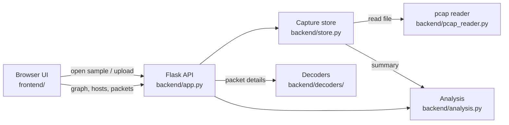

# Architecture

PCAP Lab is one Python process. Flask serves the web UI and a JSON API. A capture is read once when it is opened and kept in memory; every view is computed from those decoded packets.

## From file to screen

1. **Open.** The UI posts a sample name (`POST /api/samples/<file>/open`) or uploads a file (`POST /api/captures`). The store reads the file with `read_pcap`, computes the summary with `summarize`, and returns a capture id.
2. **Decode.** `pcap_reader.py` walks the pcap records and decodes each frame layer by layer: Ethernet → IPv4 or ARP → TCP, UDP or ICMP. Each decoded field records its byte offset and length in the frame, which is how the UI highlights bytes.
3. **Summarize.** `analysis.summarize` counts protocols, builds the per-host table (`host_table`), the top talkers and top ports, and the traffic timeline.
4. **Graph.** `GET /api/captures/<id>/graph` calls `analysis.build_graph`: one node per IP address, one undirected edge per pair of hosts, weighted by packets and bytes. NetworkX computes degree centrality and marks hubs.
5. **Packets.** `GET /api/captures/<id>/packets` returns a filtered page of the packet list. `GET /api/captures/<id>/packets/<index>` returns the decoded layers and the raw bytes as hex.
6. **Application protocols.** For packet details, `decoders.decode_application` runs the decoder registered for the packet's protocol and port, and adds its result as an extra layer.

## Application-protocol decoders

A decoder is a function in `backend/decoders/` registered with `@decoder(name, protocol, port)`. It receives the TCP or UDP payload and returns a `DecodedLayer` whose field offsets are relative to the payload; the framework converts them to frame offsets. Modules in the package are loaded automatically. `decoders/dns.py` is a complete example.

## API

| Method and path | Returns |
|---|---|
| `GET /api/health` | Status and the registered decoders |
| `GET /api/samples` | Sample captures in `samples/` (titles from `samples/catalog.json`) |
| `POST /api/samples/<file>/open` | Opens a sample; returns the capture id and summary |
| `POST /api/captures` | Uploads and opens a `.pcap` (form field `file`) |
| `GET /api/captures/<id>` | Capture summary |
| `GET /api/captures/<id>/graph?protocol=&min_packets=` | Nodes and edges |
| `GET /api/captures/<id>/hosts/<ip>` | Counters for one host |
| `GET /api/captures/<id>/packets?ip=&peer=&protocol=&port=&offset=&limit=` | A page of the packet list |
| `GET /api/captures/<id>/packets/<index>` | Layers, fields and hex bytes of one packet |

## Frontend

Plain ES modules, no build step. Cytoscape.js (vendored in `frontend/vendor/`) draws the graph.

| File | Responsibility |
|---|---|
| `js/main.js` | Start screen, opening captures, view switching, graph filters |
| `js/graph.js` | Graph rendering, selection and layout |
| `js/inspector.js` | Overview, host and conversation panels |
| `js/timeline.js` | Traffic-over-time chart (SVG) |
| `js/packets.js` | Packet list, layer tree and hex dump |
| `js/api.js` | API calls |
| `js/ui.js` | DOM and formatting helpers |
